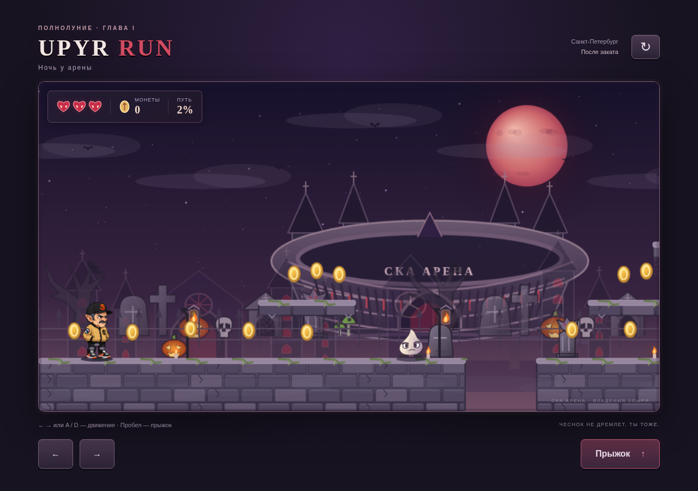
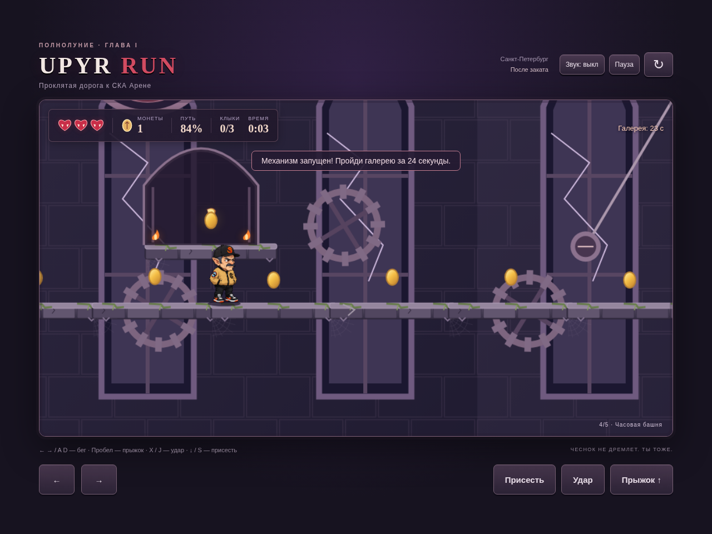
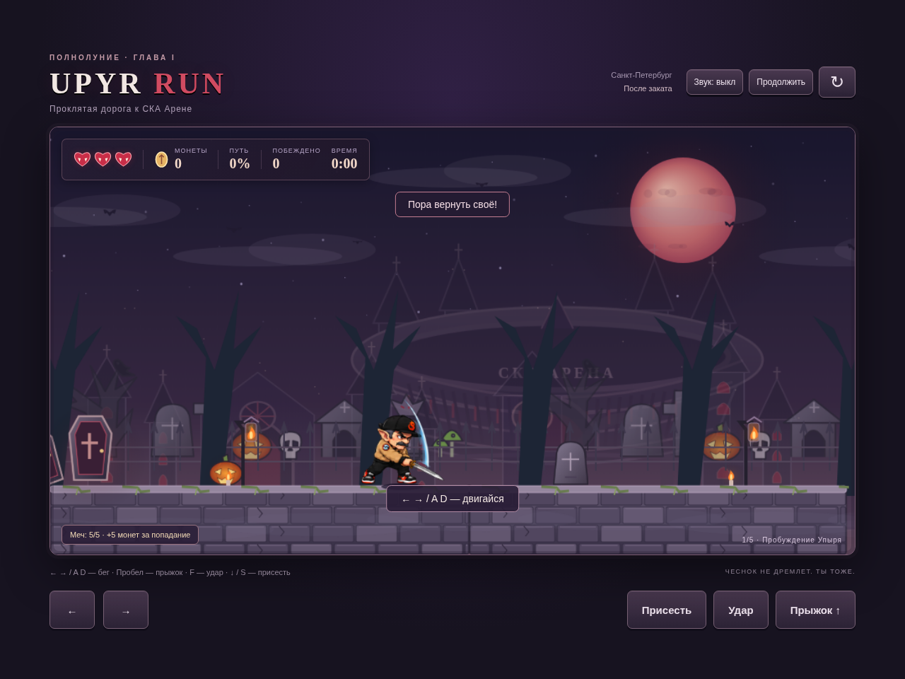
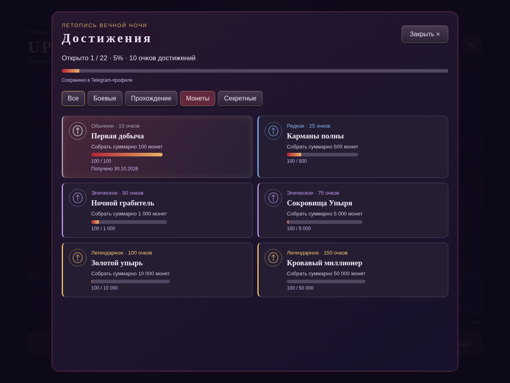

# UPYR RUN — Level 1

**Проклятая дорога к СКА Арене** — первый уровень существующего Canvas 2D-платформера. Движок, стоячий PNG героя, базовая скорость 245 px/s, прыжок 590 px/s, гравитация 1550 px/s² и Telegram `ready()/expand()` сохранены. Симуляция работает фиксированными шагами 1/120 с, независимо от частоты отрисовки.



## Запуск на Windows

1. На GitHub нажмите **Code → Download ZIP**.
2. Распакуйте архив.
3. Откройте **Worrkk.html** двойным щелчком. Это автономная версия со встроенными изображениями, без установки Node.js и без запросов в сеть.

Для разработки с Node.js 20+:

```sh
npm start
```

Откройте http://localhost:3000. Порт можно задать переменной `PORT`. Для Telegram нужен HTTPS-хостинг всех исходных JS/CSS-файлов и папки `assets`, затем URL в BotFather. Открывать исходный index.html через file:// не нужно.

## Управление

| Действие | Клавиатура | Телефон |
| --- | --- | --- |
| Движение | ← → / A D | Стрелки |
| Прыжок | Пробел / ↑ / W | Прыжок |
| Удар | F | Удар |
| Приседание | ↓ / S | Удерживать «Присесть» |
| Пауза | Escape или кнопка | Кнопка «Пауза» |

Удар требует отдельного нажатия, откат — 0,42 с. При приседании рост хитбокса уменьшается с 80 до 44 px; ноги остаются на той же поверхности. Сквозь парящие платформы можно прыгать снизу и проходить сбоку; приземление происходит ногами при падении. Ярусы выше друг друга на 90 px. Звук выключен по умолчанию; включается отдельной кнопкой после жеста пользователя, настройка сохраняется.

## Пять зон одного непрерывного уровня

| Зона | Содержание |
| --- | --- |
| Пробуждение Упыря | Открытый гроб, подсказки, первая яма, летящий чеснок, костёр, кол, более плотные патрули противников |
| Кладбище забытых игроков | Движущиеся надгробия, плиты с разрушением через 0,8 с, ямы, хоккейные шлемы,  светящийся гроб |
| Аллея охотников | Телеграфируемые колья, постоянные/циклические костры и летящий чеснок; препятствия разделены безопасными участками |
| Часовая башня | Подъём на 720 px, вертикальная камера, маятники, разрушающиеся ступени, галерея на 24 с, рычаг и побег на 45 с |
| Площадь у СКА Арены | Главный охотник с тремя фазами и тремя HP; ключ, открытие ворот, реплика Упыря, оборотень на крыше, LEVEL COMPLETE и LEVEL 2 — СКОРО |

Маршрут имеет длину 60 300 px. Автоматизированное прохождение обычными входными командами занимает около **5:12 вместе с финальной сценой**; оно побеждает 30 врагов, трижды получает меч и не использует продолжения. Это ориентир, а не обязательный таймер всего уровня. Босс после трёх выстрелов открывает шестисекундное окно для удара; ярость не позволяет снять больше одной жизни за окно.



## Противники и меч

На уровне 33 обычных противника вместо прежних 14, плюс Главный охотник. Новые патрули стоят на безопасных участках, в стороне от ям, костров и пусковых отверстий.

За каждые 10 уникальных побед выдаётся меч с прочностью **5/5**. Если меч ещё есть, следующая награда восстанавливает прочность до пяти, без накопления сверх пяти. Прыжок на врага тоже засчитывается как победа.

Каждое успешное попадание мечом по живому противнику тратит одну единицу прочности и добавляет **+5 монет** сверх обычной награды за убийство. Меч наносит два урона обычным врагам. При попадании по нескольким врагам каждый расходует одну единицу; после исчерпания прочности оставшиеся цели получают обычный удар. Босс сохраняет три фазы и теряет не более одной жизни в своё окно уязвимости.

Промахи, удары по неуязвимому боссу и отбивание снарядов прочность не тратят и бонуса не дают. После пяти успешных попаданий меч исчезает, герой продолжает бить кулаком. В интерфейсе показаны число побед, прочность или число оставшихся побед до следующего меча.

Золотые клыки, их тайники и разрушаемая стена удалены. Сюжетный рычаг башни и ворота арены продолжают работать независимо от коллекционных предметов. Старые рекорды автоматически читаются без устаревшего счётчика клыков.

## Контрольные точки, бонусы и сохранения

Контрольные точки действуют только в текущем забеге. На экране поражения можно продолжить у последнего активированного гроба с тремя жизнями или начать заново. Снимок восстанавливает собранные предметы, счёт, счётчик побед, прочность меча и побеждённых врагов на момент активации. Это предотвращает повторное накопление очков на одних предметах. Время и полученный за весь забег урон не откатываются.

Кровавая ярость длится 10 с, усиливает удар по шлемам и стене, добавляет свечение глаз и частиц. Достижение «НЕПРОКУСИМЫЙ» выдаётся при завершении без урона, включая падения, истечение таймеров и неудачные попытки до продолжения.

`progress.js` хранит в localStorage факт завершения, лучшее время до завершения боя с боссом, максимальное количество побеждённых врагов за забег, достижения и максимальный результат. Сохранение переживает перезагрузку страницы. При запрете хранилища игра продолжает работать и сообщает о невозможности сохранения.

**Это локальные, не проверенные сервером данные.** Серверной авторизации, API сохранений и таблицы лидеров в исходном проекте не было. Новая система достижений имеет отдельный серверный API (описан ниже); личный рекорд из progress.js и таблица лидеров к нему не относятся. Локальный рекорд нельзя считать доказанным онлайн-результатом. Для рейтинга необходим отдельный сервер с проверкой Telegram initData и игрового результата. В автономном HTML хранилище зависит от браузера и пути к файлу; перенос файла может создать отдельное хранилище.

## Файлы и архитектура

- `game.js` — прежний игровой цикл и Canvas-отрисовка, расширенные ударом, приседанием, объектами уровня, контрольными точками, боссом и финальной сценой.
- `level1.js` — конфигурация пяти зон, платформ, врагов, ловушек, коллекционных предметов, контрольных точек, рычага, ворот и таймеров.
- `parallax.js` — повторение слоёв с постоянными мировыми индексами, CanvasPattern для каменных фонов и плавное движение луны и арены без сбросов координат.
- `atmosphere.js` — существующий параллакс и эффекты; добавлены повторение на длинной карте, отсечение невидимых объектов, общие кэшированные текстуры и движение платформ.
- `hero-animation.js`, `assets/hero-{crouch,run,jump,attack,sword}.png` и соответствующие `*.frames.json` — покадровые приседание, бег, прыжок, удар кулаком и мечом по референсам. Силуэты бега и прыжка изолируются по метаданным и кэшируются при загрузке, чтобы перекрывающиеся области исходных атласов не показывали фрагменты соседнего кадра.
- `level-art.js`, `assets/level1/` — графика новых объектов, различия зон, интерьер башни, эффекты удара, ярости и кат-сцены.
- `progress.js` — независимое от контрольных точек постоянное локальное сохранение.
- `sound.js` — синтезированная аркадная мелодия, шаги, удар и получение урона. AudioContext не создаётся до разрешённого взаимодействия.
- `index.html`, `style.css` — интерфейс и управление, включая одновременные касания.
- `scripts/build-standalone.js` — встраивание действующих исходников и графики в Worrkk.html.
- `tests/` — модульные проверки, тестовый водитель реального ввода и браузерная проверка.

Новое представление уровня добавлено к текущей сцене без стороннего движка. Герой `assets/hero.png` и чеснок `assets/garlic.svg` оставлены без изменений. Второй уровень пока не реализован; неработающей кнопки перехода нет.

## Сборка и тестирование

```sh
npm run check
npm test
npm run build
```

`npm test` выполняет 38 проверок игровых механик, достижений и серверного хранения: карту, односторонние коллизии, прыжок при 30/60/120 Гц, приседание, движущиеся и разрушающиеся платформы, удар/ярость, ловушки, выдачу/поломку меча и монетные бонусы, контрольные точки, рычаг, фазы босса, локальное сохранение, паузу и полный маршрут до финала.

Для браузерной проверки на Linux нужны Chromium и Playwright Core вне checkout:

```sh
npm install --prefix /tmp/upyr-qa playwright-core --no-audit --no-fund
NODE_PATH=/tmp/upyr-qa/node_modules UPYR_CHROMIUM=/usr/bin/chromium node tests/browser-check.cjs
```

Браузерный тест также сравнивает пиксели фона по обе стороны шести прежних точек сброса параллакса и проверяет удар на F. Тест сам запускает сервер на 3137 и останавливает его. Проверяет полное прохождение, меч, бонус +5 монет, босса и кат-сцену, сохранение после перезагрузки, восстановление у гроба, одновременные касания, паузу, отсутствие звука до жеста, офлайн-сборку и постоянство количества объектов после 12 перезапусков. Снимки пишет в `/tmp/upyr-level1-*.png`.

Вызовы Telegram проверены с подставным SDK. HMAC-авторизация протестирована на подписанных тестовых данных, включая подмену пользователя и истечение срока. Реальный токен бота, клиент Telegram и физические Android/iOS-устройства не тестировались. В headless Chromium на экране 390 × 844 измерены интервалы кадров около 16,7 мс в лесу, на кладбище, в башне и у босса; это не гарантия 60 FPS на телефоне. Требуется аппаратная проверка.

## Временные ассеты и оставшаяся художественная работа

Технически рабочие, но предварительные SVG: `helmet.svg`, `hunter.svg`, `coffin.svg`, `stake.svg`, `sword.svg`, `gate.svg`, `werewolf.svg`, `tower.svg`. Их следует заменить или доработать для финального релиза, особенно покадровые атаки/поражение охотника и шлема. Приседание героя теперь покадровое по референсу: опускание за 0,28 с, удержание с лёгким движением и подъём за 0,28 с. Используется прозрачный атлас `assets/hero-crouch.png`, координаты и опорные точки ног — в `assets/hero-crouch.frames.json`, контроллер — `hero-animation.js`. Все кадры имеют единый масштаб по обеим осям; сжатие стоящего спрайта удалено. Для удержания используются одинаковые по размеру глубокие позы верхнего ряда референса, чтобы избежать скачка размеров на более крупных кадрах среднего ряда. Быстрая смена направления разворачивает движение из текущей глубины приседа. Хитбокс остаётся прежним 80/44 px. Бег теперь использует 16 кадров фото-референса: цикл зависит от фактически пройденного расстояния и останавливается при упоре в стену. Прыжок использует отдельные позы подготовки, отрыва, подъёма, вершины, падения, приземления и восстановления из второго фото; фаза определяется фактической вертикальной скоростью и контактом с платформой. Анимация не задерживает повторный прыжок и не меняет его силу. Бег и прыжок зеркалируются при движении влево. Графика встроена в автономный HTML. Жест поправления кепки пока нарисован эффектом руки; удар использует 12 поз референса из `assets/hero-attack.png` с координатами в `assets/hero-attack.frames.json`, клавиша — F.

Нужна ручная сверка дворца-арены с фотографическим ракурсом СКА Арены. Синтезированный звук — временное оформление, для релиза нужны музыкальная дорожка и качественные записи ветра, огня, грома и крыльев.


## Удар мечом и достижения

При наличии меча F запускает отдельную анимацию из **16 кадров** по референсу: замах, подъём клинка, рубящий удар, проводка и возврат в стойку. Используется `assets/hero-sword.png` с координатами/масками `assets/hero-sword.frames.json`; зеркалирование, масштаб тела и привязка ног сохранены. Продолжительность 0,36 с, откат 0,42 с. Отдельная нарисованная накладка меча во время этой анимации отключена, поэтому двойного клинка нет. Расчёт попаданий, дальность, физика и монетные награды сохранены.



Кнопка **«Достижения»** в меню открывает летопись с вкладками, редкостью, датами, числовым прогрессом и отдельными очками. Подготовлены все 24 достижения из задания; **22 доступны сейчас**. «Кровожадный» (50 убийств за забег) отключён: сейчас всего 34 цели вместе с боссом. «Без права на ошибку» отключён: охотника необходимо атаковать. Эти две карточки помечены как ожидающие будущих уровней и не входят в знаменатель 100%. Босс и глава сейчас одни, поэтому «Я здесь главный» и «Легенда ночи» доступны. Полный каталог уровней, глав и условий доступности находится в `achievements-core.js`; при добавлении уровня его нужно внести в этот каталог и передавать его ID/ID полного прохождения в событиях.



**Доступны:** Чесночный пресс, Один против всех, Не сегодня, Ван Хельсинг!, Машина разрушения, Чесночная диета; Настоящий упырь, Горячая штучка, Ночная смена, Огнеупорный, Вечный двигатель, Я здесь главный, Легенда ночи; четыре скрытых достижения за смерти и безопасное ожидание; шесть монетных порогов 100/500/1 000/5 000/10 000/50 000.

Монеты учитываются по операциям начисления: подбор, награда за убийство, бонус меча. Баланс и рекорд не используются для восстановления истории. Повторная отправка события и повторное получение той же награды после отката к гробу в одном забеге не увеличивают статистику второй раз. Новый честный забег учитывает сбор заново. Смерти не сбрасывают накопительную статистику; пройденное расстояние растёт только при достижении новой дальней точки забега. Костёр засчитывается после настоящего прыжка над активным пламенем и безопасного приземления за ним. Кол засчитывается после пересечения персонажа без попадания и без отбивания. Безопасное ожидание требует неподвижности на земле вдали от врагов, ловушек и снарядов; пауза не учитывается.

Уведомления идут последовательно по четыре секунды, без остановки игры; звук подчиняется существующей настройке и не создаёт AudioContext. Очки выводятся отдельно от игровых монет и вычисляются из открытых ID. Старое локальное подтверждение «НЕПРОКУСИМЫЙ» переносится в «Настоящий упырь»; дата переноса используется как дата добавления в новую систему. Локальные рекорды не импортируются в проверенный серверный Telegram-профиль.

### Постоянное серверное хранение

- `achievements-core.js` — общий каталог и детерминированный обработчик событий, одинаковый на клиенте и сервере.
- `achievements.js` — профили, локальный кеш, журнал ожидающих событий и повторная отправка.
- `achievements-ui.js` — карточки, фильтры и очередь уведомлений.
- `achievement-server.js` — POST `/api/achievements`, проверка HMAC Telegram `initData`, срок сессии 24 часа, атомарная запись профиля по проверенному User ID.

В Telegram сервер является постоянным хранилищем. Локальный кеш помогает пережить разрыв соединения; очередь сохраняется при перезапуске и синхронизируется по восстановлении связи. Операции имеют ID потока и последовательный номер; сервер повторно подтверждает уже обработанные события без повторной награды. Привязка к аккаунту определяется проверенной подписью, а не `initDataUnsafe`. Без Telegram или в автономном HTML используется отдельный локальный гостевой профиль.

Для размещения на сервере задайте переменные окружения **до** `npm start` (PowerShell):

```powershell
$env:TELEGRAM_BOT_TOKEN = "ТОКЕН_ВАШЕГО_БОТА"
$env:UPYR_DATA_DIR = "C:\upyr-data\achievements"
npm start
```

`UPYR_DATA_DIR` должна находиться на постоянном диске/volume с резервными копиями. Токен нельзя помещать в HTML, JS клиента или Git. Без токена API возвращает 503, интерфейс показывает, что серверное сохранение не настроено, и удерживает события в очереди. В текущей облачной среде токен не настроен; действующий бот не подключён. Это файловое хранилище для **одного процесса Node.js**; несколько реплик требуют общей транзакционной БД. Проверка Telegram удостоверяет аккаунт и предотвращает повтор операций, но сервер не симулирует игру заново и не является полноценным античитом.

Дополнительная браузерная проверка:

```sh
NODE_PATH=/tmp/upyr-qa/node_modules node tests/achievements-browser.cjs
```

Она поднимает сервер на 3138 с временной папкой и тестовым токеном, проверяет секретные карточки, 390px интерфейс, потерю связи, перезапуск, повторную синхронизацию и отсутствие повторных наград. Тестовые данные удаляются после проверки. Отчёт: `docs/achievements-test-results.json`. Физическую проверку внутри Telegram Android/iOS и подключение настоящего токена нужно выполнить при развёртывании. Дополнительных обязательных ассетов для этой функции нет; ручная полировка прозрачных контуров меча и отдельных именных иконок возможна перед релизом.
