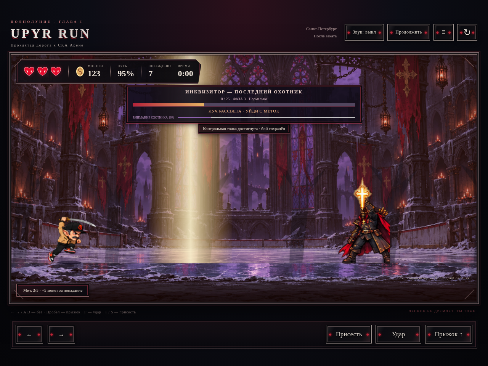

# Инквизитор — Последний охотник

В существующий Canvas 2D цикл добавлен финальный бой в ледовом дворце. Скорость, прыжок, гравитация, коллизии платформ и клавиатурное/сенсорное управление героя сохранены.

## Механики

- 18/25/35 HP на лёгкой/нормальной/сложной сложности, множители интервала ×1,3/×1/×0,8. Кулак снимает 1 HP, меч 2 HP с существующим расходом прочности. Между фазами здоровье не восстанавливается.
- Фазы 100–70%, 70–35%, 35–0%. Переход очищает несовместимые атаки; меняются поведение, предупреждения и освещение.
- Конечный автомат: INTRO, IDLE, MOVE, ATTACK, RECOVERY, STUNNED, HIT, PHASE_TRANSITION, DEATH, VICTORY; WAITING до входа. Одновременно выполняется одна атака. Очереди ограничены 32 снарядами и 16 зонами, объекты удаляются по столкновению, границам и сроку жизни.
- Шкала внимания растёт при неподвижности и повторении, снижается при движении и разнообразии. Заполнение вызывает предупреждённую атаку текущей фазы. Пауза, вступление, оглушение и финал её замораживают.

| Фаза | Атаки и защита |
| --- | --- |
| Охота начинается | Тройной горизонтальный залп на высоте головы/ног: присесть/прыгнуть. Параболический чеснок можно отбить. Капкан предварительно отмечен, после срабатывания исчезает. |
| Священная ярость | Рывок после подготовки, меч застревает в полу. УФ-граната летит по дуге, сама не ранит: отмеченная область пола активна 3 секунды. Комбинация кола и рывка имеет паузу. Ложный замах отделён от настоящего удара. |
| Последний рассвет | Луч отмечает ограниченную область; дождь кольев оставляет свободное пространство. Безумная комбинация разделяет рывок, два выстрела и гранату. «Последний приговор» заряжается 4 секунды: удар прерывает зарядку и оглушает на 3 секунды. |

Базовые паузы между атаками — 3,5/2,5/1,6 секунды по фазам. Восстановление обычно 2 секунды; после рывка, двойной комбинации и ложного замаха — 1,5 секунды. Игрок получает урон только при пересечении активного оружия, снаряда или зоны; используется существующая неуязвимость после попадания.

## Сохранение и победа

Автоматическая точка на x=57400 сохраняет достигнутый уровень, счёт, побеждённых врагов, собранные монеты и предметы, меч, открытые гробы, время, урон и идентификатор забега достижений. Она хранится в существующем ключе `upyr-run.progress.v1`; старые записи мигрируют. Отдельного хранилища прогресса не создано.

«ПОВТОРИТЬ БОЙ» восстанавливает снимок у арены, полное здоровье игрока и босса, первую фазу и чистые таймеры. Вступление пропускается. После закрытия/перезагрузки доступна кнопка продолжения сохранённого боя. Собранные до точки предметы и события достижений не начисляются повторно. Время и полученный урон учитывают неудачные попытки.

При смертельном попадании немедленно сохраняется победа, чтобы закрытие приложения во время анимации не потеряло результат. Затем проигрываются поражение, падение арбалета, подход героя и фраза «ОХОТА ОКОНЧЕНА. ТЕПЕРЬ ОХОТНИК — ТЫ». Первая победа даёт 1000 монет и «Последний упырь» однократно; сохраняет отметку завершения, деактивирует незавершённую точку и предлагает повышенную сложность. Последний снимок входа остаётся для повторного боя.

## Графика

Пять прозрачных атласов персонажа созданы по предоставленному референсу: шляпа с крестом, красный плащ, арбалет и серебряный меч. Это подготовленная по референсу графика, а не буквальное извлечение кадров из прикреплённой обзорной таблицы. Геометрические заглушки модели не используются.

17 основных последовательностей содержат 115 кадров: idle 4, walk 6, run 6, jump 5, fall 4, hit 4, death 7, crossbow 8, volley 8, garlic 7, trap 6, grenade 8, dash 8, combo 9, beam 8, rain 8, charge 9. Дополнительно подготовлены crouch 6, feint 7, recovery 5. Ноги привязаны к поверхности, силуэты изолируются масками и кэшируются при загрузке, направление зеркалируется. Эффекты и интерьер находятся в отдельных атласах. Все ресурсы встроены в автономный HTML.

Снимки: [вступление](inquisitor/intro.png), [рывок](inquisitor/phase2.png), [третья фаза](inquisitor/phase3.png), [победа](inquisitor/victory.png), [390 px](inquisitor/mobile.png).

## Изменённые файлы

| Файлы | Изменения |
| --- | --- |
| `inquisitor.js` | Новый независимый конечный автомат и атаки. |
| `inquisitor-art.js` | Покадровая графика, арена, предупреждения, эффекты. |
| `assets/inquisitor/body-{a,b,c,d,e}.png`, `effects.png`, `arena.png`, `animations.frames.json`, `effects.frames.json` | Новые атласы и метаданные. |
| `game.js` | Интеграция боя, сохранение, повтор, награда, финальная сцена. |
| `progress.js` | Миграция существующего сохранения, снимок входа, отметки и сложность. |
| `achievements-core.js`, `achievements.js` | Однократная награда и достижение, восстановление идентификатора забега. |
| `level1.js`, `level-art.js`, `atmosphere.js` | Конфигурация арены, замена прежнего охотника, исключение пересекающихся огней. |
| `index.html`, `style.css` | Здоровье и внимание, предупреждения, выбор сложности, кнопки повтора/продолжения, мобильное размещение. |
| `server.js`, `scripts/build-standalone.js`, `Worrkk.html`, `package.json` | Ресурсы, автономная сборка и команды проверки. |
| `tests/inquisitor.test.js`, `tests/inquisitor-browser.cjs` | Новые механические и браузерные проверки. |
| `tests/harness.js`, `tests/route-agent.js`, `tests/gameplay.test.js`, `tests/browser-check.cjs` | Совместимость тестового окружения и прохождение нового босса вводом. |
| `tests/achievements.test.js`, `tests/achievements-browser.cjs`, `tests/ui-browser.cjs` | Новый размер каталога достижений. |
| `README.md`, `docs/inquisitor-report.md`, `docs/inquisitor-test-results.json`, `docs/inquisitor/*.png` | Инструкция, результаты и снимки. |

## Проверки и ограничения

- `npm run check`, `npm test`, `npm run build`: успешно; 56 тестов (31 игровой, 13 достижений, 12 Инквизитора).
- Chromium: серверная и автономная версии, интро, фазы, число кадров, HUD, повтор, полное восстановление, перезагрузка, однократная награда, сложный повтор и переключение на лёгкую сложность. Ошибок JavaScript нет.
- Полный маршрут обычными входными командами: победа примерно за 5:26, пять зон, без продолжений. Отдельно пройдены все сложности с 5/5 мечом на входе: около 46/78/95 секунд, без продолжений. Во время прохождения здоровье, позиции и таймеры не подменялись; тестовый сценарий отдельного боя задаёт начальный снимок у арены.
- Освещение: одинаковые пиксели корпусов во всех восьми кадрах, 97 → 68 фонарей, опора на землю, нет пересечений с моделями и ареной. Капля крови сохраняет восемь кадров и однократный подбор.
- Ранее проверены сервер достижений, HMAC тестовых Telegram-данных и отсутствие повторной выдачи наград. Реальные Telegram Android/iOS и физические телефоны в этой среде недоступны: проверка ширины 390 px и подставного SDK не заменяет аппаратную проверку.
- Контрольная точка локальна: зависит от доступности localStorage и того же браузера/пути. При запрете записи работает в памяти текущей сессии с предупреждением; закрытие страницы такой снимок не сохраняет. Серверной синхронизации контрольных точек в исходной архитектуре нет.
- Второй уровень не добавлялся. Генерированная графика допускает дальнейшую художественную доводку переходов и пропорций; отдельного озвучивания босса нет.
